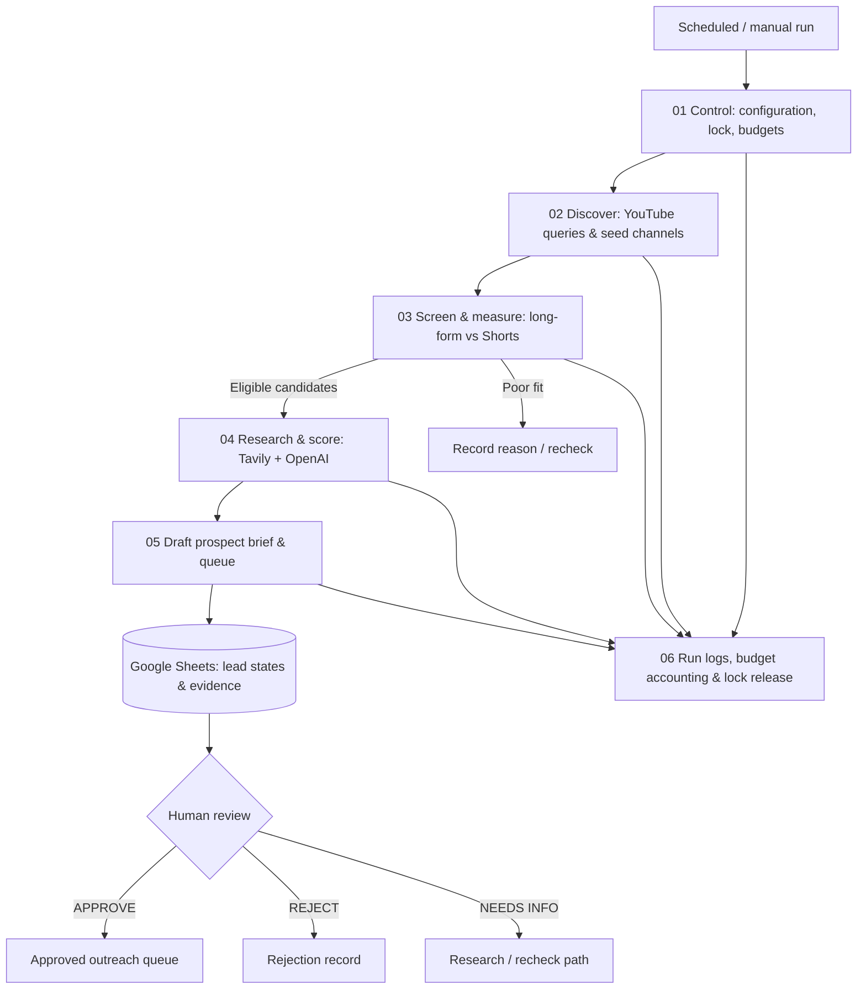

# AI-Powered YouTube Prospect Discovery & Qualification

**An n8n research pipeline for finding podcast creators with a genuine YouTube Shorts opportunity—without treating every channel as a lead.**

**Project context:** Built for [PodSplicer](https://podsplicer.com/) · **Stack:** n8n · JavaScript · YouTube Data API · Tavily · OpenAI · Google Sheets · REST APIs

**Project links**

- **[Watch the project demo on YouTube (unlisted)](https://youtu.be/Q-DgdQKXtls)**
- **[LinkedIn profile](https://www.linkedin.com/in/usmantariqdev/)** · **[LinkedIn project entries](https://www.linkedin.com/in/usmantariqdev/details/projects/)**
- **Contact:** [usmantariq4799@gmail.com](mailto:usmantariq4799@gmail.com)

> The video is unlisted but viewable by anyone with its link. The four-page engineering case study can be added to this repository separately; it is not required to understand the README.

## The business question

PodSplicer offers podcast-to-short-form content services. A large YouTube channel is not automatically a good prospect: it might already publish Shorts consistently, have little long-form material to repurpose, lack a relevant business, or have no verified contact route.

The manual alternative is slow: open channels one by one, compare recent uploads, investigate hosts and businesses, decide whether the opportunity is real, and then write outreach notes.

I designed this engine to **filter first, research second, and ask a person before outreach**. Instead of an unqualified list of names, its output is a sourced, scored, review-ready prospect.

## What comes out of a run

For each candidate that makes it through the screening stages, the system aims to assemble:

- **Channel profile:** YouTube identity, publishing consistency, long-form activity, recent Shorts usage, and the identified content gap.
- **Business research:** evidence of an associated business, monetization signals, relevant websites, and sources used to support those claims.
- **Qualification:** individual score components, a total out of 100, and a priority tier.
- **Reviewer brief:** a concise explanation of why this creator might fit, with verified contact information *only when found in source material*.
- **Decision state:** in review, approved, rejected, or needs more information, with an audit trail of the action.

**There is no automatic prospect outreach.** Approval is deliberately left to a person.

## Six-phase architecture

| Phase | How it works | Reason for the design |
|---|---|---|
| **01 — Control** | Read settings; check run lock, provider readiness and remaining API/AI budgets | Prevent overlapping runs and uncontrolled spend |
| **02 — Discover** | Search using queries and seed channels; deduplicate on YouTube channel ID | Avoid examining the same candidate repeatedly |
| **03 — Screen & Measure** | Apply lower-cost checks, then inspect uploads and compare long-form activity with Shorts | Reject obvious poor fits before paid research |
| **04 — Research & Score** | Use Tavily and OpenAI to examine business context, cross-check evidence and apply a weighted rubric | Produce a defensible opportunity assessment |
| **05 — Draft & Queue** | Write a short prospect brief and queue it for human review | Turn data into something a reviewer can act on |
| **06 — Close & Account** | Record run counts, API usage, estimated AI costs and final status; release run lock | Make the pipeline auditable and manageable |

A separate reviewer workflow processes human decisions. Google Sheets holds both operational configuration and prospect/review state.

## The qualification model — 100 points

The weighted rubric favors a meaningful content gap **and** a plausible business reason to buy podcast clipping:

| Signal | Maximum points | What it asks |
|---|---:|---|
| Shorts gap | **30** | Does the channel underuse short-form relative to its long-form output? |
| Publishing consistency | **15** | Is the podcast active enough to support recurring clips? |
| Business fit | **20** | Is there an identifiable business or professional offering behind the content? |
| Monetization signals | **15** | Are there credible signs that investing in distribution could make commercial sense? |
| Footage potential | **10** | Is the long-form material suitable for repurposing? |
| Contact signals | **10** | Is there a legitimate, source-backed way to reach the creator/business? |
| **Total** | **100** | |

**Priority bands:** Tier A = **75–100**; Tier B = **55–74**; lower scores go to nurture or recheck rather than immediate outreach.

The score is a **review aid**, not a claim that the channel will become a customer or deliver a particular conversion rate.

## The safeguards I cared most about

### Spend money only after a candidate passes cheaper checks

YouTube screening and eligibility rules are used before heavier web research and AI analysis. Settings include daily budgets and per-run controls, and the system records usage estimates. The aim is to make a scheduled research pipeline economical even when a broad search returns weak candidates.

### Don't let AI invent contact details

AI can generate a convincing-looking host name, website, or email address. That isn't enough. The pipeline checks key extracted facts against the assembled page/source evidence. If a fact or contact route isn't supported, it stays **unknown** instead of being promoted into an outreach-ready record.

### Keep decisions and history across runs

A channel is identified by its YouTube channel ID and tracked through stages such as **DISCOVERED → QUALIFIED → SCORED → IN_REVIEW**. Rejections, reasons, and recheck dates are preserved rather than starting each run from zero.

### Separate research from permission to contact

The reviewer can choose **APPROVE**, **REJECT**, or **NEEDS INFO**. Only an approved lead is eligible to enter the outreach queue. There is no automatic AI-generated outreach to unapproved candidates.

### Leave a useful operational trail

Run logs capture candidate counts, qualification outcomes, provider usage, estimated costs, and execution health. This helps explain *why* a run produced a small shortlist—or none at all.

## Example of the decision process

*Illustrative journey, not a claim about a particular real creator:*

1. A search finds a podcast channel with recent long-form episodes.
2. The engine checks publishing consistency and recent Shorts activity.
3. If the Shorts gap looks promising, it researches the host, business and relevant pages.
4. It retains only supported facts, calculates the weighted score, and writes a reviewer brief.
5. A person checks the brief and explicitly approves, rejects, or requests more information.
6. The final decision and run costs are recorded for follow-up or rechecking.

## Demonstrated outcome and limits

The documented result is a functioning **research-to-review workflow**: six coordinated phases, a defined 100-point rubric, tracked leads, budget controls, source-grounded briefs, and a human decision gate. A recorded run was used for the project walkthrough.

I am **not** presenting an unverified number of customers won, hours saved, revenue generated, or outreach conversions. Those would require separate business tracking. The project is strongest as evidence of API orchestration, controlled LLM enrichment, validation and human-in-the-loop system design.

## Repository and disclosure

This README describes the design and behavior; it is not a promise of a public, one-click runnable instance. Because the workflow was developed in a business context, any future workflow export or supporting data needs to be **reviewed and sanitized** before publication. Remove client records, Google Sheets IDs, OAuth/account identifiers, access tokens, contact details and private research data.

**Supporting materials that can be added later (optional):** architecture overview, redacted workflow screenshots, synthetic reviewer brief, and the four-page engineering case study. The video walkthrough is already linked above.

---

**Designed and implemented by [Usman Tariq](https://www.linkedin.com/in/usmantariqdev/) for [PodSplicer](https://podsplicer.com/).**
